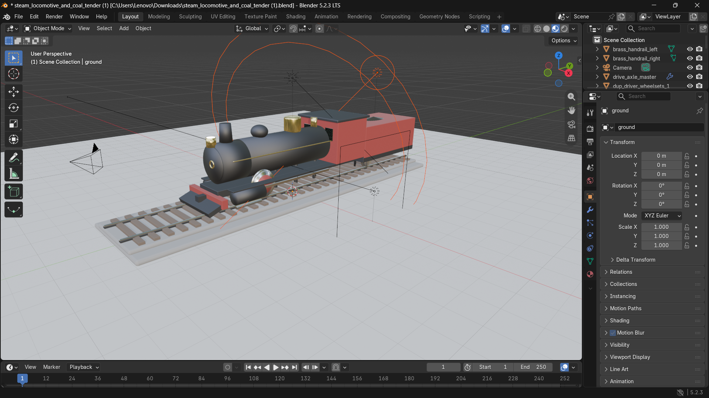
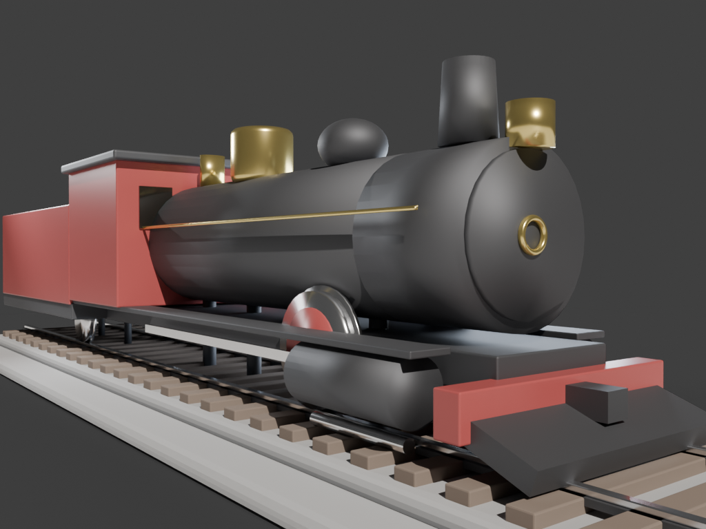
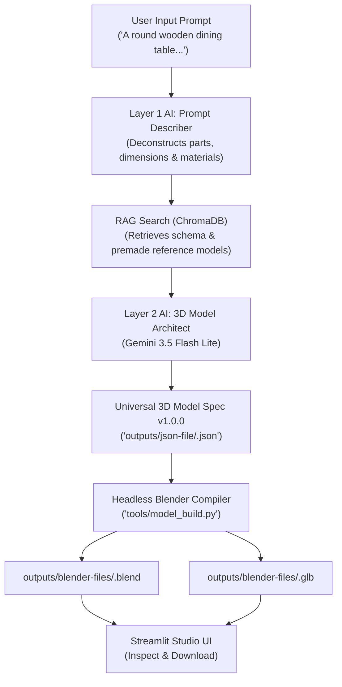

# 🧊 3D Gen AI Agent: Procedural 3D Model Generation Studio

An end-to-end autonomous AI system that translates natural language descriptions into procedural, production-ready 3D Blender scenes (`.blend`) and WebGL assets (`.glb`) using Google Gemini and LangChain RAG.

---

## 📸 Preview & Showcase

<p align="center">
  
</p>

<p align="center">
  <em>Interactive Web Studio with Dual-Layer AI Pipeline and one-click .blend / .json downloads</em>
</p>

<p align="center">
  
</p>

---

## 🌟 Key Highlights & Features

- **Dual-Layer AI Pipeline**:
  - **Layer 1 (Prompt Describer)**: Analyzes simple/vague user prompts (e.g., *"a wooden table"*) and expands them into structured physical breakdowns (sub-parts, realistic dimensions, primitive choices, and PBR material properties).
  - **Layer 2 (3D Model Architect)**: Synthesizes the technical expansion and RAG knowledge into a strictly validated **Universal 3D Model Spec (v1.0.0)** JSON document.
- **RAG Knowledge Base (ChromaDB / FAISS)**:
  - Vector search powered by `models/gemini-embedding-001`.
  - Ingests schema guidelines, API documents, and few-shot golden reference models from `data/premade_models/` to ground model generation.
- **Parametric Blender Compiler**:
  - Headless automated builder (`tools/model_build.py`) executing inside Blender.
  - Supports:
    - **Primitives**: Cubes, UV/ico spheres, cylinders, cones, toruses, planes, circles.
    - **Profiles**: 2D cross-section lathe (rotational spin) and profile extrusion (vases, chalices, pillars).
    - **Curves**: 3D Bezier and Poly curves with tube beveling and caps (pipes, wires, handles).
    - **Modifiers & Operations**: Bevels, Subdivision Surface (`subsurf`), Mirror symmetry, Array instancing, Solidify thickness, and Boolean differences.
    - **PBR Materials**: Principled BSDF node trees (metallic, roughness, specular, IOR, transmission, emission, texture mapping).
    - **Studio Scene Setup**: Automatic 3-point lighting rig (Key, Fill, Rim), camera auto-framing, and ground shadow catchers.
- **Interactive Streamlit Web Studio**:
  - Clean web interface with prompt input, pipeline parameter controls, interactive JSON inspector, and direct download buttons for `.json` specifications and compiled `.blend` scene files.

---

##  System Architecture



---

##  Project Structure

```
3d_gen_ai_agent/
├── config/
│   ├── settings.yaml                 # Blender path, output directories, model defaults
│   └── prompts/
│       ├── system_prompt.md          # Layer 2 prompt: Universal 3D Model Spec v1.0.0
│       └── description_prompt.md     # Layer 1 prompt: 3D Concept expander
├── data/
│   ├── docs/                         # Documentation & scripting references for RAG
│   ├── premade_models/               # Golden reference JSON models (tables, bookshelves, etc.)
│   └── schemas/
│       └── model_spec_1.0.0.json     # Draft-2020-12 Universal 3D Model Spec schema
├── outputs/
│   ├── json-file/                    # Generated JSON model specifications
│   └── blender-files/                # Compiled .blend and .glb files
├── src/
│   ├── llm/
│   │   ├── llm_model.py              # Gemini model initialization (gemini-3.5-flash-lite)
│   │   ├── prompt_builder.py         # Assembles system prompts, RAG docs & user queries
│   │   └── output_parser.py          # Extracts, cleans, and validates JSON output
│   ├── pipeline/
│   │   └── orchestrator.py           # End-to-end pipeline runner
│   ├── prompt_describer/
│   │   └── describer.py              # Layer 1 AI prompt expansion
│   ├── rag/
│   │   ├── chunking.py               # Document & JSON schema chunking strategies
│   │   ├── embedder_model.py         # Google Generative AI embeddings (gemini-embedding-001)
│   │   ├── ingest.py                 # RAG ingestion script
│   │   └── retriever.py              # Similarity search & metadata retriever
│   └── main.py                       # Streamlit Web Application
├── tools/
│   └── model_build.py                # Standalone Blender procedural compilation script
├── vectorstore/
│   ├── store_factory.py              # Vector store factory (ChromaDB / FAISS switchable)
│   └── chroma_db/                    # Local persistent Chroma vector database
├── .env                              # API keys (GOOGLE_API_KEY)
├── requirements.txt                  # Python project dependencies
└── README.md
```

---

##  Getting Started

### 1. Prerequisites
- Python 3.10+ (Recommended Python 3.11 - 3.14)
- [Blender](https://www.blender.org/) 5.2+ installed locally (e.g., `D:\app\blender.exe` or installed in `C:\Program Files\Blender Foundation\`)
- A [Google Gemini API Key](https://aistudio.google.com/)

---

### 2. Installation

1. Clone or navigate to the repository directory:
   ```powershell
   cd "<folder_name>\text_to_3d_blender_llm_tool_gen"
   ```

2. Install dependencies:
   ```powershell
   pip install -r requirements.txt
   # OR with uv:
   uv pip install -r requirements.txt
   ```
   *(Note: `bpy` and `mathutils` are provided directly inside Blender's executable and do not need to be installed in your standard Python environment).*

---

### 3. Configuration

1. **Set your Google API Key in `.env`**:
   ```env
   GOOGLE_API_KEY=AIzaSy...your_actual_key_here
   ```

2. **Configure your Blender path in `config/settings.yaml`**:
   ```yaml
   blender:
     executable_path: "<path>\\blender.exe"
     timeout_seconds: 120
   ```

---

### 4. Populate the RAG Vector Store (One-Time Setup)

Ingest reference models and schemas from the `data/` folder into ChromaDB:

```powershell
python .\src\rag\ingest.py
```

---

### 5. Launch the Web Studio UI

Start the Streamlit application:

```powershell
streamlit run .\src\main.py
```

Open your browser at **`http://localhost:8501`**.

---

##  CLI / Programmatic Usage

You can also run model generation directly from Python scripts:

```python
from src.pipeline.orchestrator import generate_3d_pipeline

success, spec, expanded_desc, raw_output, json_path, blend_path = generate_3d_pipeline(
    user_description="A Scandinavian minimalist bedside table with a pull-out drawer and brass handle",
    use_describer=True,
    use_rag=True,
    temperature=0.4
)

if success:
    print(f"JSON specification saved to: {json_path}")
    print(f"Blender scene compiled to: {blend_path}")
```

### Manual Blender Build
To compile any existing `.json` model spec directly from the terminal:
```powershell
& "D:\app\blender.exe" -b -P tools/model_build.py -- outputs/json-file/model.json --out outputs/blender-files
```

---

##  License
MIT License. Built for procedural 3D generation research and rapid asset prototyping.
